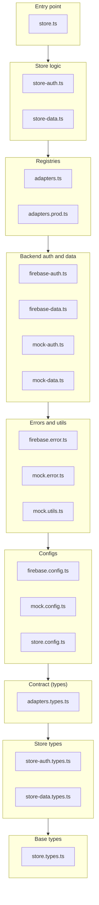

# core/store

The data and authentication layer of the app. Features talk to **one file** (`store.ts`).
Everything else is internal and can be swapped: the backend (Firebase or mock) is chosen in one place.

## Structure

```
core/store/
├── README.md                  this file
├── store.ts                   entry point: AuthStore + DataStore (the only file features use)
├── store.config.ts            BACKEND switch ('firebase' | 'mock'), development builds only
├── store.types.ts             base types: StoreError, Identifiable, operations, error codes,
│                              COLLECTION_KEYS and DOCUMENT_KEYS (+ derived CollectionKey / DocumentKey)
├── store-auth.ts              auth logic (signals), uses the active adapter
├── store-auth.types.ts        AuthUser, auth errors, AuthInterface
├── store-data.ts              collections + documents: shared helpers, error channels, validation
├── store-data.types.ts        StoreCollection, StoreDocument, Validator
│
├── adapters/
│   ├── adapters.ts            dev registry: picks the active adapter (BACKEND)
│   ├── adapters.prod.ts       production registry: Firebase only (swapped in via fileReplacements)
│   └── adapters.types.ts      contract every backend implements + PathResolver + path table types
│
├── firebase-adapter/
│   ├── firebase.config.ts     Firebase init, injection tokens, persistent cache, ignore undefined
│   ├── firebase.error.ts      Firestore error codes -> store error codes
│   ├── firebase-auth.ts       Firebase Auth part (+ its own auth error mapping)
│   └── firebase-data.ts       Firestore collections + documents + path tables
│
└── mock-adapter/
    ├── mock.config.ts         seed data (users, store)
    ├── mock.utils.ts          in-memory database, change notification, stripUndefined
    ├── mock.error.ts          mock exception class + store error mapping
    ├── mock-auth.ts           auth mock: delays, saved user (mock-user-uid) + its auth error mapping
    └── mock-data.ts           collections + documents mock: delays + path tables
```

19 files. Types live in `*.types.ts` files (`store.types.ts` also holds the key lists).

## Dependency flow

An arrow means "may import from". Every tier may import from any tier below it, **never from above**.
Code is on top, types are at the bottom, and the types never import code.



If the diagram does not render in your viewer, use the table below: it lists what each file actually imports
(generated from the code and checked: no cycles, no upward import).

### Imports per file

```
store.types.ts       -
store-auth.types.ts  -
store-data.types.ts  store.types
adapters.types.ts    store-auth.types, store.types
store.config.ts      -
firebase.config.ts   -
mock.config.ts       -
mock.utils.ts        mock.config
firebase.error.ts    adapters.types
mock.error.ts        adapters.types, store.types
firebase-auth.ts     adapters.types, firebase.config, store-auth.types
firebase-data.ts     adapters.types, firebase.config, firebase.error
mock-auth.ts         adapters.types, mock.utils, store-auth.types
mock-data.ts         adapters.types, mock.error, mock.utils
adapters.ts          adapters.types, firebase-auth, firebase-data, mock-auth, mock-data, store.config
adapters.prod.ts     adapters.types, firebase-auth, firebase-data
store-auth.ts        adapters, store-auth.types
store-data.ts        adapters, adapters.types, store-auth.types, store-data.types, store.types
store.ts             store-auth, store-auth.types, store-data, store-data.types, store.types
```

## Rules

1. Features import only `store.ts` (`AuthStore`, `DataStore`), plus the types and keys they need.
2. No upward imports. The `*.types.ts` files never import code.
3. Only `adapters.ts` and `adapters.prod.ts` import the two backend folders.
4. `adapters.prod.ts` must never import anything from `mock-adapter/`. The production build replaces
   `adapters.ts` with it (`fileReplacements` in `angular.json`), so the mock and its seed data stay out
   of the release bundle.
5. Backend files never import the store (`store.ts`, `store-auth.ts`, `store-data.ts`). The signed-in user
   comes in as a parameter.
6. Entity types belong to the features: `inject(DataStore).collection('recurrencies', isRecurrence)`.
   The type is inferred from the validator (optional). Without a validator, write the type yourself.

## Adding a collection or a document

1. Add the key to `COLLECTION_KEYS` or `DOCUMENT_KEYS` in `store.types.ts`.
2. Add its path in `firebase-data.ts`. A missing entry is a compile error.
3. Add its path in `mock-data.ts` (and seed data in `mock.config.ts` if wanted). A missing entry is a compile error.
4. Paths under `users/{uid}/` are already covered by the Firestore Security Rules (configured in the
   Firebase console). A path outside `users/{uid}/` needs its own rule, or it is denied.

## Release checklist

1. `angular.json`, production configuration of the build target:
   ```json
   "fileReplacements": [
     { "replace": "src/app/core/store/adapters/adapters.ts", "with": "src/app/core/store/adapters/adapters.prod.ts" }
   ]
   ```
2. `package.json` script that fails if the mock is still in the production build:
   ```json
   "check:bundle": "ng build --configuration production && ! grep -r \"aaa@aaa.com\" dist/"
   ```
   The e-mail address is the marker in `mock.config.ts`. If you change it there, change it here.
3. Firestore Security Rules (Firebase console): owner-only access under `users/{userId}/{document=**}`.

## Behaviors worth knowing

1. Read errors and write errors are kept apart internally. The public `error` signal shows the write
   error first. A write error stays until the next write or until the user changes.
2. After a failed read the stream ends and the last items stay on screen. Screens should show `error()`,
   or they present stale data as current. Auth behaves the same way (a failed state listener keeps the last user).
3. A write when no path is available (nobody signed in) reports `UNAUTHENTICATED`.
4. `undefined` fields are ignored on write (Firestore setting; the mock does the same). Use `null` to clear a field.
5. Deleting an item that does not exist succeeds silently (like Firestore).
6. `StoreError.collection` holds the key (e.g. `recurrencies`), not the full path.
7. Firebase: the persistent offline cache is shared between tabs and stays on the device after logout.
8. Mock: reads and writes are delayed by constants at the top of `mock-data.ts` and `mock-auth.ts`.
   The signed-in user (uid only) is saved in `localStorage` under `mock-user-uid`. Data is not saved,
   so a user created by signup starts signed out after a reload.
